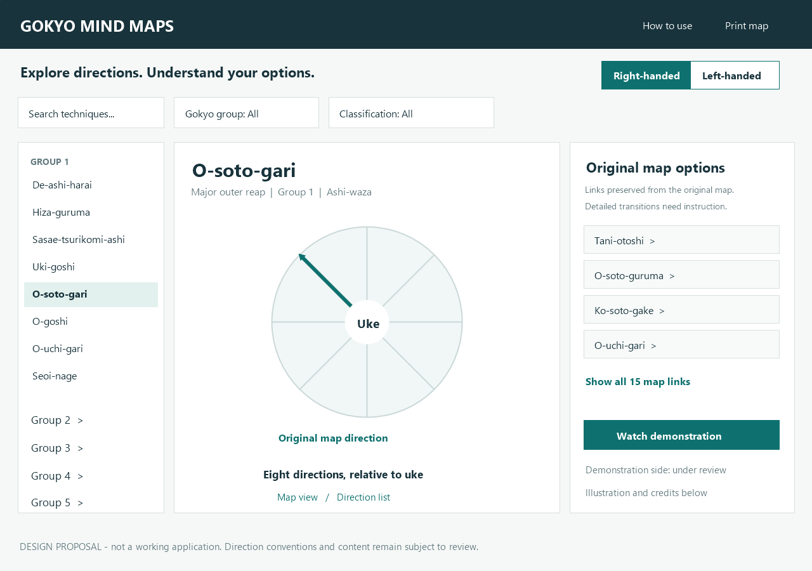
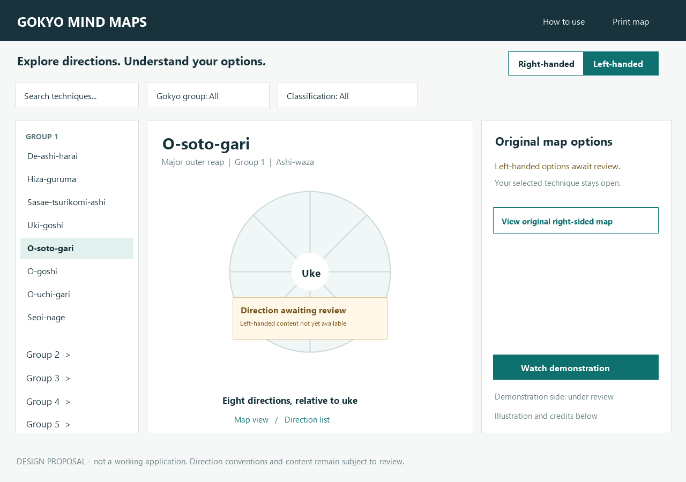
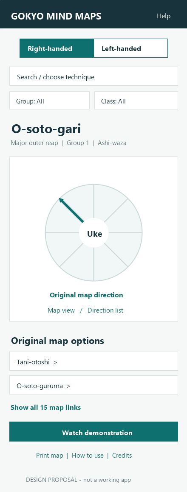
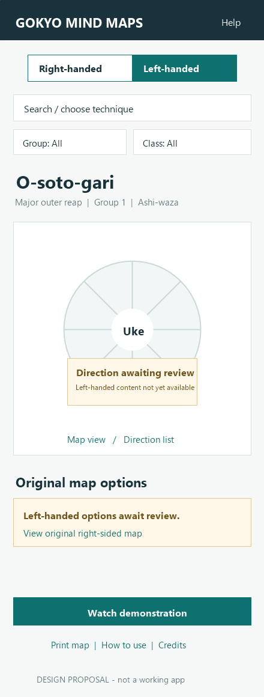

# V2 first-release scope and design proposal

Status: prepared for user review; no production replacement built or deployed.

## Recommended first release

Preserve the directional learning model, all 40 technique identities, five Gokyo groups, corrected classifications, introduction/help, original map relationships with explicit review status, technique imagery where reuse is supported, video associations, credits and printing. Right-handed remains default; left-handed is an explicit saved preference with reviewed content and honest unavailable states.

Proposed scope boundary: no new Ne-waza technique content in the first release. The original under-construction page remains documented in the baseline. Help can explain the throwing-technique scope; do not carry an unfinished grappling section into V2 as a completed feature.

Defer accounts, a backend/database service, learning scores, pronunciation audio, comparison tools and bookmarks. Do not introduce operating costs for features the original does not need.

## Desktop example

Three areas: searchable/grouped technique navigator, eight-direction map with the selected technique, and its original map options/media. Selecting an option changes the technique while retaining filters and the chosen stance. A visible Back control/history must restore the previous selection. Include a full original-map view preserving every source option and multiple placements; the summary list cannot replace directional context.

The sketches show four of O-soto-gari's actual 15 source map links in a preview list, with Show all 15 map links. List order in this drawing is illustrative. Do not infer approved combination mechanics or new direction assignments from this visual. The reviewed full map must place the links using their source evidence, including footer-coordinate conversion.

## Phone example

Keep the stance choice and selected technique readable. Collapse the 40-technique navigator into a searchable chooser. Put the map above a scrollable option list; retain group/classification filters. A Direction list provides a keyboard/screen-reader equivalent of the map. It must preserve directional grouping, duplicates/variants and selection context. Pan/zoom may supplement this but cannot be the only way to operate it.

## Interaction requirements

- Stance: accessible two-choice control, visible selected state, remembered across navigation/visits. It changes execution side, not viewer orientation.
- Map: eight clear directions, readable labels, primary arrow(s) and separate sectors. Keyboard equivalents and text explanations; group identity is conveyed by names/numbers as well as color.
- Filters: intersect group and classification; search Japanese names, aliases and English labels. Filtering never changes the content classification or deletes source evidence.
- Options: distinguish original-source links from reviewed combinations/counters. Preserve multiple meaningful placements and provide review/status context without implying technical approval.
- Media: demonstration side identified; closing/Escape/navigation stops playback and restores keyboard focus. Preserve the exact video IDs unless a reviewed replacement is approved.
- Print: current technique/map, stance, direction legend, useful options and required credits. Keep a text equivalent; no controls or clipped content. Final print layout remains to be designed.
- Navigation: return to the overview consistently, support browser Back/Forward, and preserve old technique identifiers/deep links with explicit static redirects/mappings.
- Imagery: readable captions and correct classifications; no mirrored typography, unsupported side claims or contradictory embedded captions.
- Help: preserve the introduction's big-picture purpose and explain that transition details need instruction.

## Proposed technical approach, to confirm after design review

A small static TypeScript application, reusable SVG map components and explicit reviewed content records can preserve GitHub Pages hosting without a server or user accounts. Library/build-tool versions will be checked when implementation starts. No framework or package has been installed or committed.

Separate immutable original evidence from corrected taxonomy, anatomical semantics, side-specific variants, relationship reviews, media provenance and UI preferences. Do not use raw screen coordinates as judo semantics. Keep historical route IDs stable even if displayed names become hyphenated.

These PNGs are static layout proposals. They contain no reused third-party technique artwork and are not acceptance-tested application screens.

The drawings establish layout and unavailable states, not final artwork. The full map must retain the original option placements and recognizable group identity (numbers/names and the five-group color legend). Anatomy labels/foot indicators come from the reviewed direction convention, not from the simplified circles in these sketches.
